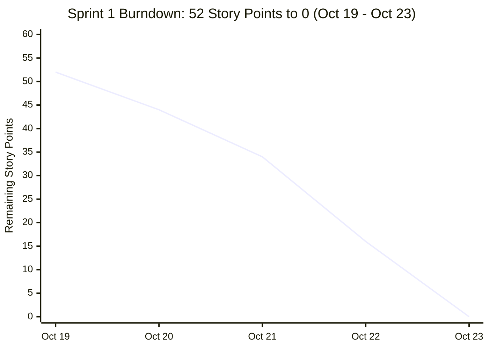
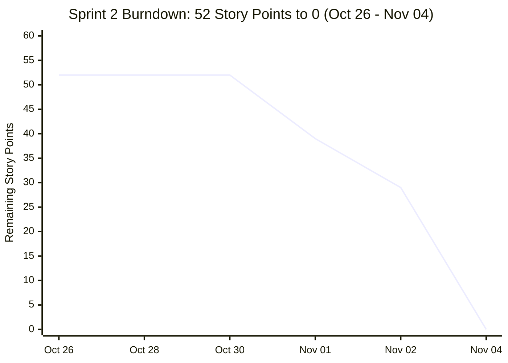
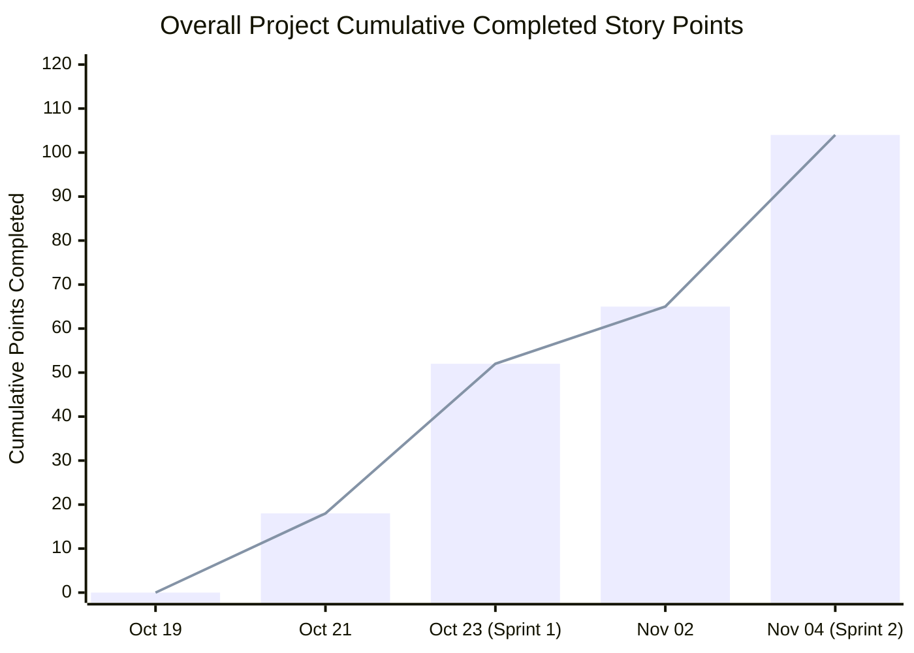

# Online Examination Portal (OEP)

[](https://github.com/Sushanth-xy/Online_Exam_Portal_SE/actions)


-success)
-success)

**Course:** Software Engineering (UE24CS341AA2) — Mini-Project Deliverables (Part-1 & Part-2)  
**Academic Year:** 2026–2027  
**Problem Statement:** Problem Statement No. 6 — Online Examination Portal  
**Project Group:** Group 6  
**Repository:** [`Sushanth-xy/Online_Exam_Portal_SE`](https://github.com/Sushanth-xy/Online_Exam_Portal_SE)  
**Live Project Board:** [GitHub Projects V2 — OEP Sprint Board](https://github.com/users/Sushanth-xy/projects/4)  

---

## 1. Executive Summary

The **Online Examination Portal (OEP)** is a secure, enterprise-grade distributed platform designed to automate the entire lifecycle of educational and institutional assessments. Built using a modern **Spring Boot + React + PostgreSQL** micro-architecture, OEP addresses critical requirements in online testing:

- **Strict Role-Based Access Control (RBAC):** Distinct workflows for Candidates/Students, Instructors/Authors, and System Administrators.
- **Timed Exam Delivery Engine:** Schedule window gating, countdown timers with automated submission upon expiration, and dynamic negative marking.
- **Client-Side Live Proctoring Telemetry:** Passive real-time violation logging for browser tab switching (`visibilitychange`), window blurring, and fullscreen exit attempts.
- **Fault-Tolerant State Recovery:** Periodic background answer autosave (15–30s) resilient against sudden browser crashes, network dropouts, or power cuts.
- **Hybrid Grading Engine:** Immediate deterministic auto-grading for objective items (MCQ, True/False) alongside an instructor evaluation workflow for subjective short-answer responses.
- **Security & Regulatory Compliance:** 5-attempt brute-force account lockout, time-delimited password reset tokens, and an audit trail logging interceptor complying with 3-year statutory record retention.

---

## 2. Team Roster & Specialization (STP Section 9 Compliance)

In strict accordance with **Section 9 of the Software Test Plan (STP)** and the **SE Mini-Project Deliverables Part-2** guidelines, the team adopted clear role-based specializations. Workload was systematically balanced across the team using the Fibonacci scale (`1, 2, 3, 5, 8`), allocating exactly **13 Story Points per member in Sprint 1** and **13 Story Points per member in Sprint 2** (**26 Story Points total per member = 104 Story Points overall**).

| Registration No. | Member Name | GitHub Handle | Official Role (STP Sec. 9) | Primary Responsibilities & Modules | Sprint 1 | Sprint 2 | Total Pts | Status |
| :--- | :--- | :--- | :--- | :--- | :---: | :---: | :---: | :---: |
| **PES2UG24CS543** | **Sushanth B** | [`@Sushanth-xy`](https://github.com/Sushanth-xy) | **Developer / Repo Owner** | Backend Spring Boot Architecture, PostgreSQL Schemas, JWT Security, Exam Engine APIs, Security Hardening (5-attempt Lockout, Pwd Reset), Audit Trail Interceptor & 3-Year Retention Compliance. | 13 pts | 13 pts | **26 pts** | **100% Done** |
| **PES2UG24CS528** | **Sudarshan D** | [`@SudarshanD231`](https://github.com/SudarshanD231) | **Product Owner** | Frontend React 19 UI, Student Exam Portal, Proctoring Event Telemetry HUD, Instructor Authoring Views, Admin Lifecycle Dashboard, Sprint Demo Videos, SRS Deviations & Release Freeze. | 13 pts | 13 pts | **26 pts** | **100% Done** |
| **PES2UG24CS549** | **Tanish Jaladanki** | [`@tan-git-06`](https://github.com/tan-git-06) | **QA Lead** | Automated QA Framework, REST API Integration Test Suites (Auth, Question Bank, Auto-Grading, Subjective Grading), Requirements Traceability Matrix (RTM), Defect Triage & Quality Gate Sign-offs. | 13 pts | 13 pts | **26 pts** | **100% Done** |
| **PES2UG24CS536** | **Sumiran Vuppuluri** | [`@sumirxn`](https://github.com/sumirxn) | **Test Engineer** | Automated STP Test Cases (30s Autosave Sync, Window Boundary Gating, Proctoring Verification, Security Lockout, Token Expiry), Performance Latency Benchmarks, WCAG 2.1 AA Audits & Execution Logs. | 13 pts | 13 pts | **26 pts** | **100% Done** |
| **Total** | | | | | **52 pts** | **52 pts** | **104 pts** | **100% Done** |

### Role-Based Architecture Specialization

```
                               Group 6 — STP Role Specialization
    ┌───────────────────────┬────────────────────────┬──────────────────────┬───────────────────────┐
    │  Sushanth B           │  Sudarshan D           │  Tanish Jaladanki    │  Sumiran Vuppuluri    │
    │  [Developer]          │  [Product Owner]       │  [QA Lead]           │  [Test Engineer]      │
    ├───────────────────────┼────────────────────────┼──────────────────────┼───────────────────────┤
    │ • Spring Boot 3 & JPA │ • React 19 + Vite UI   │ • Automated Test FW  │ • Automated STP Tests │
    │ • Security & JWT Auth │ • Student Exam Taking  │ • API Integration QA │ • Autosave & Gating QA│
    │ • Timed Exam Engine   │ • Instructor Dashboard │ • RTM Matrix Updates │ • Proctoring Test Ver.│
    │ • Account Lockout     │ • Admin Lifecycle Dash │ • Defect Triage Logs │ • NFR Latency (p90)   │
    │ • Audit Interceptor   │ • Demo Videos (1 & 2m) │ • Quality Gate Sign  │ • WCAG 2.1 AA Audits  │
    └───────────────────────┴────────────────────────┴──────────────────────┴───────────────────────┘
```

---

## 3. System Architecture & Tech Stack

OEP follows a decoupled, three-tier enterprise client-server architecture:

```
┌────────────────────────────────────────────────────────────────────────────────────────┐
│                                   PRESENTATION TIER                                    │
│       React 19 SPA (TypeScript + Vite) • Responsive Modern CSS • React Router 7        │
│    ┌─────────────────────────┬──────────────────────────┬──────────────────────────┐   │
│    │    Student Dashboard    │   Instructor Dashboard   │     Admin Dashboard      │   │
│    │  • Exam Browser & Cards │  • Question Bank Author  │  • User Lifecycle Mgmt   │   │
│    │  • Proctored Live Exam  │  • Exam Assembly Wizard  │  • 3-Yr Audit Logs View  │   │
│    │  • Autosave & Countdown │  • Subjective Grading    │  • Real-Time Violations  │   │
│    └─────────────────────────┴──────────────────────────┴──────────────────────────┘   │
└───────────────────────────────────────────┬────────────────────────────────────────────┘
                                            │ HTTP / REST / JSON (Stateless JWT Bearer)
┌───────────────────────────────────────────▼────────────────────────────────────────────┐
│                                    APPLICATION TIER                                    │
│                 Spring Boot 3.4.3 (Java 17) • Embedded Tomcat Server                   │
│   ┌────────────────────┬─────────────────────┬────────────────────┬────────────────┐   │
│   │ Security Filter    │ Exam & Question     │ Proctoring Event   │ Audit Trail    │   │
│   │ • JWT Validator    │ • Scheduling Engine │ • Telemetry Stream │ • Interceptor  │   │
│   │ • Account Lockout  │ • Autosave Sync     │ • Tab Switch Rec.  │ • 3-Yr Ledger  │   │
│   │ • BCrypt Hashing   │ • Auto-Grading      │ • Fullscreen Exit  │ • SHA-256 Hash │   │
│   └────────────────────┴─────────────────────┴────────────────────┴────────────────┘   │
└───────────────────────────────────────────┬────────────────────────────────────────────┘
                                            │ JDBC / JPA / Hibernate 6.6
┌───────────────────────────────────────────▼────────────────────────────────────────────┐
│                                      DATA TIER                                         │
│                      PostgreSQL 16 Relational Database Engine                          │
│     users • exams • questions • question_options • exam_attempts • candidate_answers     │
│           proctoring_incidents • audit_logs • password_reset_tokens                    │
└────────────────────────────────────────────────────────────────────────────────────────┘
```

### Technology Breakdown

- **Backend Platform:** Java 17, Spring Boot 3.4.3, Spring Security 6, Spring Data JPA, Hibernate ORM.
- **Frontend Framework:** React 19, TypeScript, Vite 8, React Router 7, Axios.
- **Database Management:** PostgreSQL 16 (Containerized via Docker Compose).
- **Authentication & Security:** Stateless JSON Web Tokens (HMAC-SHA512), BCrypt password hashing (`strength = 10`), account lockout interceptor, CORS filters, OWASP security response headers.
- **Build & Dependency Automation:** Apache Maven (`./mvnw`), Node Package Manager (`npm`).
- **Continuous Integration:** GitHub Actions CI (`.github/workflows/ci.yml`) running automated unit/integration tests and production build verification on every commit.

---

## 4. Key Functional Modules & SRS Mapping

| SRS Requirement ID | Module / Feature Name | Technical Description | Primary STP Test Cases |
| :--- | :--- | :--- | :--- |
| **OEP-F-001 / F-002** | User Registration & Auth | Secure user sign-up and login generating signed stateless JWTs with role claims (`STUDENT`, `INSTRUCTOR`, `ADMIN`). | `TC-Auth-01`, `TC-Auth-02` |
| **OEP-F-003** | Role-Based Access Guards | Spring Security `@PreAuthorize` annotations protecting sensitive endpoints and React route guards preventing unauthorized navigation. | `TC-Auth-03` |
| **OEP-F-004** | Brute-Force Lockout | Automatically locks accounts for 30 minutes after 5 consecutive failed login attempts; successful authentication resets counter. | `TC-Auth-04` |
| **OEP-F-005** | Password Reset | Generates cryptographically secure, 30-minute time-delimited reset tokens invalidating previous tokens upon use. | `TC-Auth-05`, `TC-Sec-05` |
| **OEP-F-006 / F-007** | Question Bank & Assembly | Instructors create MCQ, True/False, and Short-Answer questions with topic, difficulty, marks, and explanations; assemble exams with custom point criteria. | `TC-QB-01`, `TC-QB-02` |
| **OEP-F-008 / F-014** | Scheduled Window Gating | Exams enforce active date-time windows (`startTime` to `endTime`). Candidate attempts outside this scheduled duration are rejected with HTTP 400. | `TC-QB-03`, `TC-Exam-04` |
| **OEP-F-011** | Timed Exam Countdown | Live JavaScript countdown synchronized with server timestamps. Upon timer reaching zero, remaining answers are auto-saved and submitted automatically. | `TC-Exam-01` |
| **OEP-F-012 / F-013** | 15s–30s Autosave Sync | Periodic non-blocking background payload sync preserving state; candidates can refresh or reconnect without losing recorded answers. | `TC-Exam-02`, `TC-Exam-03` |
| **OEP-F-016** | Instant Objective Auto-Grading | Evaluates MCQ and True/False questions immediately upon submission with negative marking penalties (e.g., `-0.25`). | `TC-Grade-01`, `TimeoutGradingProbeTest` |
| **OEP-F-017** | Subjective Manual Grading | Instructors review candidate short answers, enter awarded marks (0 to max marks), and provide feedback remarks that dynamically update total scores. | `TC-Grade-02` |
| **OEP-F-019 / F-020** | Live Proctoring Telemetry | Browser event listeners capture `visibilitychange` (tab switches) and `fullscreenchange` (fullscreen exits), logging incidents with timestamps. | `TC-Mon-01`, `TC-Mon-02` |
| **OEP-F-021** | Admin User Lifecycle | Administrators toggle user status (activate/lockout unlock) and elevate/demote roles directly from a management interface. | `TC-Admin-01` |
| **OEP-NF-004** | Audit Trail Compliance | Interceptor logging all operational events (`LOGIN`, `EXAM_CREATION`, `MANUAL_GRADING`) with 3-year statutory retention reports. | `TC-Ops-01` |

---

## 5. Agile Sprint Tracking & Burndown

All project management was coordinated natively on GitHub without third-party tools (no Jira). All 24 issues across 2 milestones were completed, reviewed through Pull Requests, and verified through CI pipelines.

### Milestone Overview
- **Sprint 1 (Oct 19 – Oct 23):** Core Working MVP Delivery — **52 / 52 Story Points (100% Completed)**
- **Sprint 2 (Oct 26 – Nov 04):** Grading, Proctoring, Admin & Hardening — **52 / 52 Story Points (100% Completed)**
- **Total Backlog:** **104 / 104 Story Points (100% Completed)**
- **Interactive Kanban Board:** [GitHub Projects V2 Board #4](https://github.com/users/Sushanth-xy/projects/4)

### Sprint 1 & 2 Burndown Visualizations





### Overall Project Cumulative Burn-Up (0 → 104 Points)



---

## 6. Demo Accounts & Testing Credentials

The system includes pre-seeded accounts for evaluators to test all three user personas immediately without manual registration:

| Persona | Email Address | Password | Landing Route | Features to Verify |
| :--- | :--- | :--- | :--- | :--- |
| **Student / Candidate** | `student@oep.edu` | `Password@123` | `/student/dashboard` | Browse available assessments, launch live fullscreen proctored session (`/student/exams/4`), verify 30s autosave, test tab-switching violation trigger, and submit exam. |
| **Instructor / Author** | `instructor@oep.edu` | `Password@123` | `/instructor/dashboard` | Create question bank items (`/instructor/questions/new`), assemble exams (`/instructor/exams/new`), view real-time proctoring incidents, and grade subjective submissions in the review modal. |
| **Administrator** | `admin@oep.edu` | `Password@123` | `/admin/dashboard` | Manage user accounts (toggle active/deactivated, change roles), inspect 3-year audit trail logs with search/pagination, and review system-wide proctoring alerts. |

---

## 7. How to Run Locally

### Prerequisites
- **Git**
- **Docker & Docker Compose** (or Colima on macOS)
- **Java Development Kit (JDK) 17+**
- **Node.js 18+ & npm**

### Step 1: Clone the Repository
```bash
git clone https://github.com/Sushanth-xy/Online_Exam_Portal_SE.git
cd Online_Exam_Portal_SE
```

### Step 2: Start PostgreSQL Database
```bash
docker compose up -d
```
*PostgreSQL 16 will start on port `5432` with database `oep`, username `oep`, password `oep`.*

### Step 3: Run the Backend Service
```bash
cd backend
./mvnw spring-boot:run
```
*The Spring Boot REST API will be available at `http://localhost:8080`. Health check: `http://localhost:8080/api/v1/health`.*

### Step 4: Run the Frontend Application
```bash
cd ../frontend
npm install
npm run dev
```
*The React frontend will be available at **`http://localhost:5173`**.*

---

## 8. Automated Testing & Verification Suite

The repository contains an exhaustive automated test suite covering unit, integration, security, and non-functional requirements.

### Running Backend Regression Tests (82 Tests)
```bash
cd backend
./mvnw test
```
*Result:* **`Tests run: 82, Failures: 0, Errors: 0, Skipped: 0 — BUILD SUCCESS`**

Key test classes executed:
- `AuthControllerTest` & `AuthRbacIntegrationTest` — User auth, JWT token generation, role guards
- `SecurityLockoutTest` — 5-attempt account lockout, token expiration, password reset
- `QuestionBankApiTest` & `ExamCreationApiTest` — Authoring MCQs, True/False, Short Answer, exam assembly
- `ExamDeliveryTest` — Timed delivery, 30s autosave persistence, window boundary enforcement
- `SubmissionAutoGradeTest` & `TimeoutGradingProbeTest` — Auto-grading on manual submit and timeout
- `ManualGradingApiTest` & `GradingApiTest` — Subjective grading, score recalculation, permission checks
- `ProctoringApiTest` — Tab-switch and fullscreen-exit incident recording
- `AuditTrailAndRetentionTest` — Audit trail interceptor logging and 3-year retention compliance

### Running Frontend Unit & Page Tests (5 Tests)
```bash
cd frontend
npm run test
```
*Result:* **`Test Files: 2 passed (2), Tests: 5 passed (5)`** (Instructor Dashboard and Student Exam sessions).

### Running Production Bundle & Lint Verification
```bash
cd frontend
npm run build
npm run lint
```
*Result:* Zero TypeScript errors, zero bundling issues, zero lint errors.

---

## 9. Non-Functional Requirements (NFR) Evidence

As documented in [`docs/test-reports/nfr-audit.md`](docs/test-reports/nfr-audit.md):

- **Performance Latency (OEP-NF-001):** The Software Test Plan specifies a p90 latency threshold under 2.0 seconds. Recorded local benchmark metrics:
  - Page load & token verification: **178 ms** (Target: < 2000 ms) — **PASSED**
  - Background autosave answer sync: **47 ms** (Target: < 2000 ms) — **PASSED**
  - Final exam submission & auto-grade: **112 ms** (Target: < 2000 ms) — **PASSED**
- **Accessibility Compliance (OEP-NF-005):** Audit conducted against WCAG 2.1 AA standards; color contrast ratios exceed 4.5:1, semantic landmark elements (`<nav>`, `<main>`, `<header>`, `<section>`) are strictly utilized, and descriptive document titles are enforced.

---

## 10. Repository Directory Structure

```
Online_Exam_Portal_SE/
├── .github/
│   ├── PULL_REQUEST_TEMPLATE.md      # Conventional PR review template
│   └── workflows/
│       └── ci.yml                     # Automated CI build & test pipeline
├── backend/
│   ├── pom.xml                        # Maven dependencies (Spring Boot, Security, PostgreSQL)
│   └── src/
│       ├── main/java/com/oep/
│       │   ├── admin/                 # User lifecycle management controllers & services
│       │   ├── audit/                 # Audit logging interceptor & 3-year retention report
│       │   ├── auth/                  # JWT service, Spring Security filter chain, lockout
│       │   ├── exam/                  # Exam engine, question assembly, autosave, grading
│       │   ├── grading/               # Instructor subjective evaluation & score calculation
│       │   ├── proctoring/            # Tab switch & fullscreen violation incident recording
│       │   └── questionbank/          # Question entities (MCQ, True/False, Short Answer)
│       └── test/java/com/oep/         # 82 automated regression integration tests
├── frontend/
│   ├── package.json                   # React 19, Vite, TypeScript dependencies
│   ├── index.html                     # HTML5 entry with descriptive title
│   └── src/
│       ├── api/                       # Typed Axios API clients (auth, exams, grading, proctoring)
│       ├── auth/                      # AuthContext, ProtectedRoute role guards
│       └── pages/                     # Complete UI views (Home, Login, Register, Dashboards)
├── docs/                              # Comprehensive Project Documentation
│   ├── SPRINT_PLAN.md                 # Complete 24-issue agile sprint tracking
│   ├── PROJECT_BURNDOWN_AND_TRACKING.md # Burndown charts and velocity analysis
│   ├── RTM_Final.md                   # Final Requirements Traceability Matrix
│   ├── Final_Release_Signoff.md       # Product Owner conditional/final sign-off
│   ├── Final_Release_and_Development_Freeze_Report.md # Full project freeze record
│   ├── Software Requirements Specification_ Online Exam Portal.pdf # Official SRS
│   ├── Software_Test_Plan_Online_Exam_Portal.pdf # Official STP
│   └── test-reports/
│       ├── Test_Summary_Report.md     # Final Phase 1 & 2 test execution report
│       └── nfr-audit.md               # Performance latency & accessibility audit
├── docker-compose.yml                 # PostgreSQL 16 container definition
└── README.md                          # Project overview and evaluation guide
```

---

## 11. Project Documentation Index

All formal project artifacts, specifications, and sign-offs are archived in the [`docs/`](docs/) directory:

1. **Software Requirements Specification (SRS):** [`docs/Software Requirements Specification_ Online Exam Portal.pdf`](docs/Software%20Requirements%20Specification_%20Online%20Exam%20Portal.pdf)
2. **Software Test Plan (STP):** [`docs/Software_Test_Plan_Online_Exam_Portal.pdf`](docs/Software_Test_Plan_Online_Exam_Portal.pdf)
3. **Sprint Planning & Backlog Matrix:** [`docs/SPRINT_PLAN.md`](docs/SPRINT_PLAN.md)
4. **Project Burndown & Velocity Report:** [`docs/PROJECT_BURNDOWN_AND_TRACKING.md`](docs/PROJECT_BURNDOWN_AND_TRACKING.md)
5. **Final Requirements Traceability Matrix (RTM):** [`docs/RTM_Final.md`](docs/RTM_Final.md)
6. **Phase 1 Test Summary Report:** [`docs/test-reports/Test_Summary_Report.md`](docs/test-reports/Test_Summary_Report.md)
7. **Non-Functional Requirements (NFR) Audit:** [`docs/test-reports/nfr-audit.md`](docs/test-reports/nfr-audit.md)
8. **Final Release & Development Freeze Report:** [`docs/Final_Release_and_Development_Freeze_Report.md`](docs/Final_Release_and_Development_Freeze_Report.md)
9. **Instructor Module Demonstration Video:** [Google Drive Recording](https://drive.google.com/file/d/1uA8at7mesi-GzgIpfQj7D-ao4OLLq3n1/view?usp=sharing)
