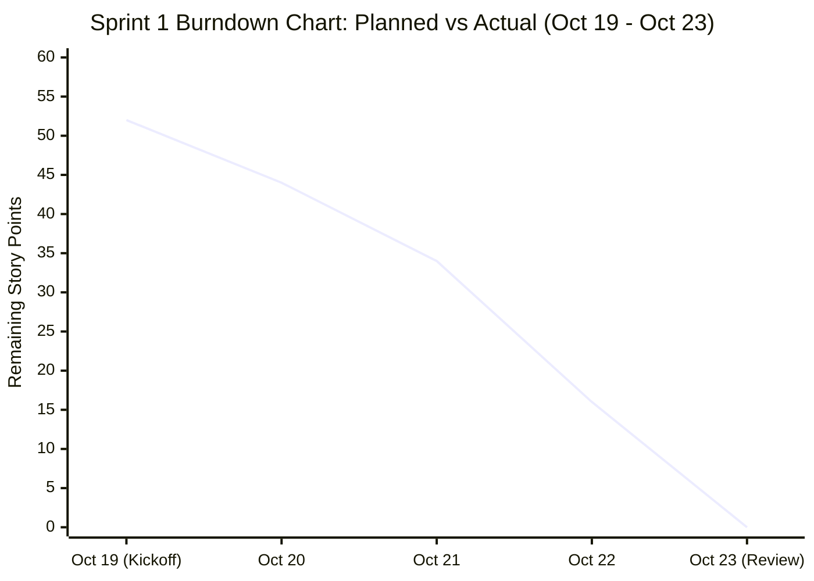
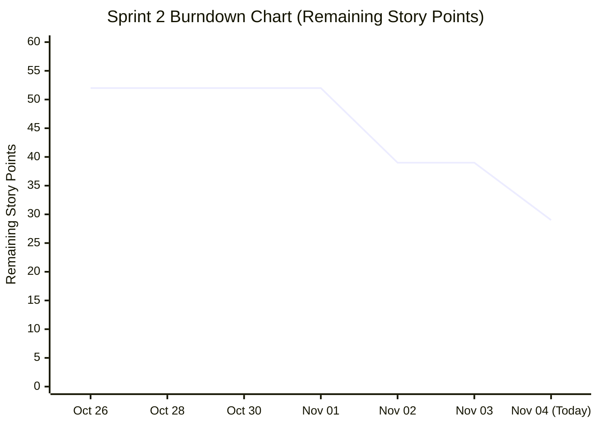
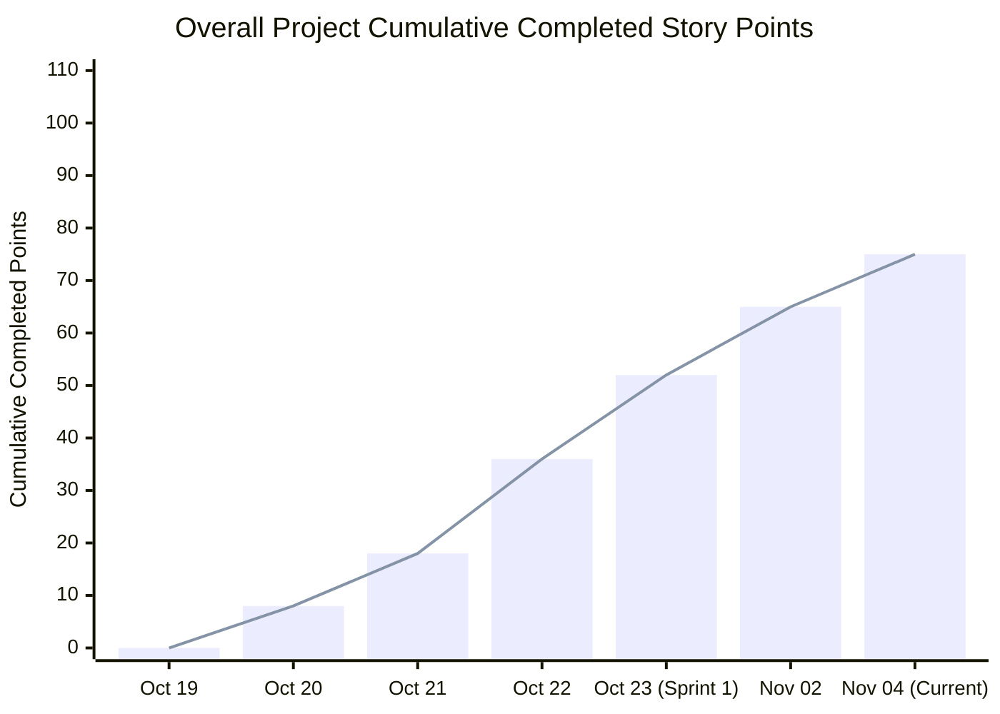

# Online Exam Portal (OEP) — Project Tracking & Burndown Report

**Document Version:** 1.0  
**Project Group:** Group 6 — Problem Statement No. 6  
**Course:** Software Engineering (Mini-Project Deliverables Part-2)  
**Repository:** [`Sushanth-xy/Online_Exam_Portal_SE`](https://github.com/Sushanth-xy/Online_Exam_Portal_SE)  
**Date of Snapshot:** November 4, 2026  

---

## 1. Executive Summary & Sprint Health

```
========================================================================================
PROJECT PROGRESS OVERVIEW: 75 / 104 STORY POINTS COMPLETED (72.1%)
========================================================================================
Total Project Backlog:       104 Story Points (Fibonacci scale: 26 pts per team member)
Sprint 1 (MVP Delivery):     52 / 52 Story Points (100.0% Complete — ACCEPTED)
Sprint 2 (Hardening & QA):   23 / 52 Story Points (44.2% Complete — IN PROGRESS)
Remaining Backlog:           29 Story Points (Sprint 2 QA & Final Acceptance Freeze)
Automated Tests Passing:     72 / 72 passing (0 failures, 0 errors)
========================================================================================
```

---

## 2. Burndown & Burnup Visualizations

### 2.1 Sprint 1 Burndown (Oct 19 – Oct 23) — Completed (52 pts → 0 pts)



#### Sprint 1 Daily Burndown Data

| Date | Phase / Milestone | Issues Completed | Points Burnt | Remaining Points | Ideal Burndown |
| :--- | :--- | :--- | :---: | :---: | :---: |
| **Oct 19** | Sprint 1 Kickoff & Environment Setup | Baseline | 0 | **52** | 52.0 |
| **Oct 20** | CI/CD & Core Auth Backend | #2 (3 pts), #3 (5 pts) | 8 | **44** | 39.0 |
| **Oct 21** | Frontend Auth Views & Auth RBAC Tests | #8 (5 pts), #5 (5 pts) | 10 | **34** | 26.0 |
| **Oct 22** | Exam Delivery Engine & Question UI | #4 (5 pts), #11 (5 pts), #6 (5 pts), #9 (3 pts) | 18 | **16** | 13.0 |
| **Oct 23** | Window Gating, Defect Logs & Demo Video | #12 (5 pts), #7 (3 pts), #10 (3 pts), #13 (5 pts) | 16 | **0** | 0.0 |

---

### 2.2 Sprint 2 Burndown (Oct 26 – Nov 04) — In Progress (52 pts → 29 pts)



#### Sprint 2 Daily Burndown Data

| Date | Issues Completed | Story Points Burnt | Remaining Points | Status Notes |
| :--- | :--- | :---: | :---: | :--- |
| **Oct 26** | Sprint 2 Kickoff (Grading, Security, Proctoring) | 0 | **52** | Baseline commitment |
| **Nov 02** | #14 (Subjective Grading API — 5 pts)<br>#15 (Account Lockout & Pwd Reset — 5 pts)<br>#16 (Audit Trail Interceptor — 3 pts) | 13 | **39** | Developer sprint commitments 100% finished |
| **Nov 04** | #20 (Student Exam Taking UI — 5 pts)<br>#24 (Proctoring & Admin Dashboard UI — 5 pts) | 10 | **29** | Product Owner frontend features merged into `main` |
| **Remaining** | #17, #18, #21, #22, #23 (QA Suites), #19 (Audit), #25 (Demo) | — | **29** | Assigned to QA Lead, Test Engineer & Final Demo |

---

### 2.3 Cumulative Project Burn-Up Chart (0 → 75 Points)



---

## 3. Team Member Velocity & Contribution Breakdown

In accordance with **STP Section 9**, each team member is assigned exactly **26 Story Points** (13 pts in Sprint 1, 13 pts in Sprint 2).

| Team Member | Official Role | Reg. No. | Sprint 1 Pts | Sprint 2 Pts Done | Sprint 2 Pts Pending | Total Pts Completed | % Completed |
| :--- | :--- | :--- | :---: | :---: | :---: | :---: | :---: |
| **Sushanth B** | Developer / Repo Owner | PES2UG24CS543 | 13 / 13 | 13 / 13 | 0 | **26 / 26** | **100.0%** 🏆 |
| **Sudarshan D** | Product Owner | PES2UG24CS528 | 13 / 13 | 10 / 13 | 3 (#25) | **23 / 26** | **88.5%** |
| **Tanish Jaladanki** | QA Lead | PES2UG24CS549 | 13 / 13 | 0 / 13 | 13 (#17, #18, #19) | **13 / 26** | **50.0%** |
| **Sumiran Vuppuluri** | Test Engineer | PES2UG24CS536 | 13 / 13 | 0 / 13 | 13 (#21, #22, #23) | **13 / 26** | **50.0%** |
| **Total** | | | **52 / 52** | **23 / 52** | **29 / 52** | **75 / 104** | **72.1%** |

---

## 4. Detailed Backlog Issue Status Matrix

### Sprint 1: Core Portal & Exam Engine MVP (All 52 Points Done)

| Issue | Title | Assignee | Role | Points | PR | Status |
| :---: | :--- | :--- | :--- | :---: | :---: | :---: |
| [#2](https://github.com/Sushanth-xy/Online_Exam_Portal_SE/issues/2) | CI/CD Automated Build & Test Pipeline | `@Sushanth-xy` | Developer | 3 | #26 | **CLOSED** |
| [#3](https://github.com/Sushanth-xy/Online_Exam_Portal_SE/issues/3) | User Registration, Authentication & JWT Security | `@Sushanth-xy` | Developer | 5 | #27 | **CLOSED** |
| [#8](https://github.com/Sushanth-xy/Online_Exam_Portal_SE/issues/8) | Auth Views: Interactive Login, Register & Guards | `@SudarshanD231` | Product Owner | 5 | #29 | **CLOSED** |
| [#5](https://github.com/Sushanth-xy/Online_Exam_Portal_SE/issues/5) | Automated Auth & RBAC Security Tests | `@tan-git-06` | QA Lead | 5 | #30 | **CLOSED** |
| [#4](https://github.com/Sushanth-xy/Online_Exam_Portal_SE/issues/4) | Exam Engine, Question Bank & Timed Delivery | `@Sushanth-xy` | Developer | 5 | #31 | **CLOSED** |
| [#11](https://github.com/Sushanth-xy/Online_Exam_Portal_SE/issues/11) | Instructor Dashboard & Question Assembly UI | `@SudarshanD231` | Product Owner | 5 | #34 | **CLOSED** |
| [#6](https://github.com/Sushanth-xy/Online_Exam_Portal_SE/issues/6) | Automated Question Bank & Exam Creation Tests | `@tan-git-06` | QA Lead | 5 | #35 | **CLOSED** |
| [#9](https://github.com/Sushanth-xy/Online_Exam_Portal_SE/issues/9) | Automated 30s Autosave & State Recovery Tests | `@sumirxn` | Test Engineer | 5 | #32 | **CLOSED** |
| [#12](https://github.com/Sushanth-xy/Online_Exam_Portal_SE/issues/12) | Automated Exam Window Gating & Boundary Tests | `@sumirxn` | Test Engineer | 5 | #33 | **CLOSED** |
| [#7](https://github.com/Sushanth-xy/Online_Exam_Portal_SE/issues/7) | Sprint 1 Test Execution Logs & Defect Reports | `@sumirxn` | Test Engineer | 3 | #36 | **CLOSED** |
| [#10](https://github.com/Sushanth-xy/Online_Exam_Portal_SE/issues/10) | Sprint 1 Quality Gate, Defect Triage & RTM Matrix | `@tan-git-06` | QA Lead | 3 | #37 | **CLOSED** |
| [#13](https://github.com/Sushanth-xy/Online_Exam_Portal_SE/issues/13) | Sprint 1 Demo Video (1 min), Acceptance Sign-off | `@SudarshanD231` | Product Owner | 3 | #38 | **CLOSED** |

---

### Sprint 2: Grading, Proctoring, Admin & Hardening (23 Pts Done / 29 Pts Remaining)

| Issue | Title | Assignee | Role | Points | PR / Commit | Status |
| :---: | :--- | :--- | :--- | :---: | :---: | :---: |
| [#14](https://github.com/Sushanth-xy/Online_Exam_Portal_SE/issues/14) | Subjective Question Manual Grading & Feedback API | `@Sushanth-xy` | Developer | 5 | #39 (`574149c`) | **CLOSED** |
| [#15](https://github.com/Sushanth-xy/Online_Exam_Portal_SE/issues/15) | Security Hardening: Account Lockout & Password Reset | `@Sushanth-xy` | Developer | 5 | #40 (`644c526`) | **CLOSED** |
| [#16](https://github.com/Sushanth-xy/Online_Exam_Portal_SE/issues/16) | System Audit Trail Logging Interceptor & 3-Year Retention | `@Sushanth-xy` | Developer | 3 | #41 (`b98ca6d`) | **CLOSED** |
| [#20](https://github.com/Sushanth-xy/Online_Exam_Portal_SE/issues/20) | Student Exam Portal: Timer, Question Palette & Autosave | `@SudarshanD231` | Product Owner | 5 | #42 (`d9366b0`) | **CLOSED** |
| [#24](https://github.com/Sushanth-xy/Online_Exam_Portal_SE/issues/24) | Proctoring Alerts & Admin User Lifecycle Dashboard | `@SudarshanD231` | Product Owner | 5 | #43 (`13087d7`) | **CLOSED** |
| [#17](https://github.com/Sushanth-xy/Online_Exam_Portal_SE/issues/17) | Automated E2E Exam Submission & Auto-Grading Tests | `@tan-git-06` | QA Lead | 5 | — | **OPEN** |
| [#18](https://github.com/Sushanth-xy/Online_Exam_Portal_SE/issues/18) | Automated Subjective Grading & Results Verification | `@tan-git-06` | QA Lead | 5 | — | **OPEN** |
| [#21](https://github.com/Sushanth-xy/Online_Exam_Portal_SE/issues/21) | Automated Proctoring Verification (Tab-Switch/Fullscreen) | `@sumirxn` | Test Engineer | 5 | — | **OPEN** |
| [#22](https://github.com/Sushanth-xy/Online_Exam_Portal_SE/issues/22) | Security Test Verification: Account Lockout & Token Expiry | `@sumirxn` | Test Engineer | 5 | — | **OPEN** |
| [#23](https://github.com/Sushanth-xy/Online_Exam_Portal_SE/issues/23) | Non-Functional: Sub-2s Latency & WCAG 2.1 AA Audit | `@sumirxn` | Test Engineer | 3 | — | **OPEN** |
| [#19](https://github.com/Sushanth-xy/Online_Exam_Portal_SE/issues/19) | Final Quality Audit, Defect Sign-off & RTM Freeze | `@tan-git-06` | QA Lead | 3 | — | **OPEN** |
| [#25](https://github.com/Sushanth-xy/Online_Exam_Portal_SE/issues/25) | Sprint 2 Demo Video (2 min), SRS Deviations & Release | `@SudarshanD231` | Product Owner | 3 | — | **OPEN** |

---

## 5. Live GitHub Project Board (Cloud Kanban)

The project board is created, linked to the repository, and populated with all 24 issues:

- **Live Project URL:** [https://github.com/users/Sushanth-xy/projects/4](https://github.com/users/Sushanth-xy/projects/4)
- **Repository Projects Tab:** Accessible directly from [Online_Exam_Portal_SE / Projects](https://github.com/Sushanth-xy/Online_Exam_Portal_SE/projects)
- **Status Columns:**
  - **Done:** 17 issues (All 12 Sprint 1 issues + Sprint 2 issues #14, #15, #16, #20, #24)
  - **Todo:** 7 issues (#17, #18, #19, #21, #22, #23, #25)
